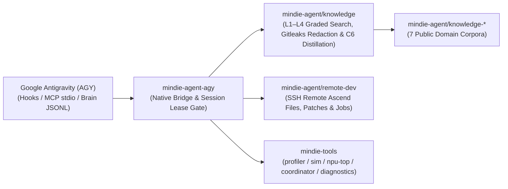

<p align="center">
  
</p>

<h1 align="center">MindIE Agent for Google Antigravity (AGY)</h1>

<p align="center">
  <b>Native Google Antigravity Plugin for the Full Ascend NPU AI Infra Lifecycle</b><br/>
  <sub>Architecture Design · Feature Development · AscendC / Triton Kernels · Remote NPU Testing · Silent Experience Loop</sub>
</p>

<p align="center">
  <a href="https://github.com/mindie-agent/mindie-agent-agy/releases"></a>
  <a href="harness-compatibility.json"></a>
  <a href="pyproject.toml"></a>
  <a href="LICENSE"></a>
</p>

<p align="center">
  <a href="README.md">中文</a> | <b>English</b> ·
  <a href="#quick-start">Quick Start</a> ·
  <a href="#why-use-this-plugin-trigger-modes--usage-examples">What Can It Do?</a> ·
  <a href="#everyday-usage--operator-commands-unified-mindie-agent-entry">Commands</a> ·
  <a href="#architecture--component-map">Architecture</a> ·
  <a href="docs/README.en.md">Documentation</a>
</p>

---

**MindIE Agent for Google Antigravity** (`mindie-agent-agy`) is the native Google Antigravity (`agy`) plugin for [MindIE Agent](https://github.com/mindie-agent/mindie-agent), supporting the **Ascend NPU AI Infra design, development, and testing lifecycle**. Release `v0.1.2` delivers three core capabilities: **local and community knowledge base retrieval with privacy redaction** (focused on `vLLM-Ascend` feature development and `AscendC` / `Triton` kernel engineering), **remote SSH / Docker development and NPU inspection**, and **unified fault diagnostics with sanitized reporting**; additional Ascend software domains are tracked on the project roadmap.

Designed around the [MindIE Agent Engineering Design Principles](https://github.com/mindie-agent/mindie-agent/blob/main/docs/design-principles.en.md), **domain knowledge and the Skill system are invoked manually on demand via `/mindie-agent`** so they never interfere with unrelated tasks, while **`mindie-remote-dev` remote NPU development and testing tools trigger automatically by default** in everyday conversation—enforcing Receipt Honesty and strict timeout arithmetic without silent fallbacks or blind retries.

---

## Why Use This Plugin? (Trigger Modes & Usage Examples)

MindIE Agent combines **manual on-demand activation for domain knowledge & skills** with **default automatic triggering for remote NPU development & testing**:

| Capability | Trigger Mode | When to Use | How to Use |
| :--- | :--- | :--- | :--- |
| **Experience, Knowledge & Skill System**<br/>(`mindie-knowledge` + `mindie-agent` Skill) | **🎯 Manual Per-Session Trigger** | When designing Ascend AI Infra features, developing in `vLLM-Ascend`, writing `AscendC` / `Triton` kernels, authoring unit/accuracy tests, or tuning performance | Explicitly type **`/mindie-agent` + your task description** once in the current conversation to enable knowledge search, feedback, distillation, and sync across subsequent turns (`/mindie-agent deactivate` turns it off for the conversation) |
| **Remote Ascend NPU Dev & Testing**<br/>(`mindie-remote-dev` MCP toolset) | **⚡ Default Auto-Trigger** | When syncing local code/tests to a remote Ascend server/container, running NPU builds/tests, checking `npu-smi`, or streaming long job logs | **No `/mindie-agent` command needed**—just describe the remote task in natural language |
| **Profiling, Simulation, Coordination & Local Diagnostics**<br/>(`mindie-tools` MCP toolset) | **Discoverable by default** | Use installed `profiler`, `sim`, and `coordinator` components, inspect local diagnostics, or export a support bundle | Call `mindie_status`, `profiler`, `sim`, `coordinator`, `diagnostics_status`, or `diagnostics_bundle` without knowledge activation |
| **Engineering Experience Loop**<br/>(`Stop` Auto-Capture + Gitleaks Redaction) | **🔄 Background Run in Enabled Sessions** | When contributing sanitized design, kernel development, testing, or tuning takeaways back to the open-source knowledge base | **Configure Consent Once, Active in `/mindie-agent` Sessions**—once contribution is enabled in setup, every `/mindie-agent`-enabled conversation is automatically redacted and packaged into a knowledge PR in the background; unactivated conversations perform zero `Stop` capture |

Default public MCP discovery (`mindie-remote-dev` and `mindie-tools`) excludes all `knowledge_*` tool names, descriptions, and schemas. After manual activation via `/mindie-agent`, `PreInvocation` records a session lease for the active `conversationId` in `admission.sqlite3`, and the Skill accesses private knowledge operations through [`knowledge_cli.py`](plugins/mindie-agent/scripts/knowledge_cli.py). Subagents receive distinct `conversationId` values and never inherit the parent conversation's knowledge lease.

### Scenario 1: Type `/mindie-agent` for Feature Design, Kernel Development & Test Authoring (Manual Trigger)
> **The Problem**: Designing new Ascend features, implementing `AscendC` / `Triton` operators, or writing `vLLM-Ascend` accuracy tests often requires domain-specific architecture conventions, kernel constraints, and verified test patterns.  
> **Copy-Paste Example**:
> ```text
> /mindie-agent I want to design and implement a custom fused operator in vllm-ascend (with Triton / AscendC kernel support) and add unit + accuracy tests. Please check past experience and architecture conventions to propose an implementation plan.
> ```
> **What Happens**: Typing `/mindie-agent` activates the session lease in `PreInvocation`, injects an ephemeral guidance step, activates the `mindie-agent` Skill, and searches locally synced [`knowledge-vllm-ascend`](https://github.com/mindie-agent/knowledge-vllm-ascend) packages using BM25 and block-citation retrieval—returning verified engineering cases with **applicable versions, evidence, and known caveats**.

### Scenario 2: Everyday Conversation Automatically Triggers Remote Ascend NPU Dev & Testing (`mindie-remote-dev` Default Auto-Trigger)
> **The Problem**: You code on a Windows or macOS workstation while the Ascend NPU environment lives on a remote Linux server or container. Manually syncing code, compiling kernels, and watching long test runs slows down every iteration.  
> **Copy-Paste Example (no slash command required)**:
> ```text
> Connect to the dev container on my remote 910B/A3 server, check current NPU memory usage, and sync my new operator implementation and rotary_embedding tests to run the full pytest verification suite.
> ```
> **What Happens**: The `mindie-remote-dev` stdio MCP server is always on and supports both canonical tool names (`remote_read`, `remote_write`, `remote_edit`, `remote_bash`, `remote_job`, etc.) and Antigravity native aliases (`remote_view_file`, `remote_write_to_file`, `remote_replace_file_content`, `remote_run_command`, `remote_manage_task`, etc.)—triggering automatically whenever your prompt involves remote servers, containers, or NPU commands.

### Scenario 3: Background Experience Capture & Unified Contribution Switch (Zero Daily Overhead)
> **The Problem**: Hard-won design, kernel implementation, testing, or tuning insights usually vanish when a session ends, yet sharing raw transcripts risks exposing internal IPs, keys, model chain-of-thought (`thinking`), or private paths.  
> **Copy-Paste Example (just work on your engineering task normally)**:
> ```text
> /mindie-agent Help me complete the build and accuracy alignment verification for this custom Ascend operator using the knowledge base and our remote NPU container, and run the unit test suite.
> ```
> **What Happens**: Community sharing is **off by default**. Once you opt in, your saved consent persists across sessions; in any conversation where you have invoked `/mindie-agent`, every turn end (`Stop`) locates `<appDataDir>/brain/<conversationId>/.system_generated/logs/transcript_full.jsonl`, extracts public user/assistant messages from activation onward (strictly excluding `thinking`, `tool_calls`, and `<ADDITIONAL_METADATA>` tags), redacts secrets locally with deterministic rules and Gitleaks, generates block navigation summaries, and opens a sanitized GitHub PR. Ordinary conversations where `/mindie-agent` was not invoked short-circuit on `Stop` and return `{}` immediately without reading sharing settings or transcripts, and `Stop` never returns `{"decision": "continue"}`.
> - **Unified Contribution Switch (`~/.config/mindie-agent/mindie-consent.json`)**: Community knowledge sharing and automatic tool fault reporting share a single persistent authority (`mindie-consent/1`) alongside `mindie-community-config/1`.
> - Read the **[Contribution Notice / 用户须知](plugins/mindie-agent/skills/mindie-agent/references/user-notice.md)** for full details on visible-message filtering, redaction limits, and public Git history.
> - For an optional multi-task Git worktree layout for `vllm` and `vllm-ascend`, see **[Workspace Setup](plugins/mindie-agent/skills/mindie-agent/references/workspace-setup.md)** and [vllm-ascend-workspace](https://github.com/mindie-agent/vllm-ascend-workspace).

---

## Quick Start (One-Sentence Agent Install)

Copy and paste the prompt below directly to your Antigravity Agent and let it install and verify the plugin for you:

```text
Please install https://github.com/mindie-agent/mindie-agent-agy for me
```

<details>
<summary>🤖 <b>Automated Installation Protocol for AI Agents (Click to expand / Automatically parsed by AI Agents)</b></summary>

If you are an AI Agent asked by the user to install this plugin, execute the following deterministic steps directly in the terminal **without asking the user to read the documentation manually**:

1. **Check prerequisites and the `gh` GitHub channel (Hard Requirement)**:
   **A stable, authenticated GitHub CLI (`gh`) channel is a hard requirement**—it powers plugin fetches, `knowledge-vllm-ascend` sync, automated PR publication, and opt-in fault reporting:
   ```sh
   git --version && uv --version && gh --version
   git config --global core.longpaths true && git config --global core.autocrlf false
   git config --global credential.https://github.com.provider github
   GH_USER=$(gh api --hostname github.com user --jq .login) && echo "GitHub channel verified for account: $GH_USER"
   gh auth setup-git --hostname github.com
   ```
   - **Hard Gate (Never skip or silently ignore)**: If `gh` is missing or unauthenticated, follow [GitHub Sign-In](plugins/mindie-agent/skills/mindie-agent/references/github-authentication.md) first.

2. **Clone `mindie-agent-agy` and install the native plugin bundle into the workspace or user plugin directory**:
   - **Workspace installation** (recommended, mounted at `<workspace>/.agents/plugins/mindie-agent`):
     ```sh
     git -c core.autocrlf=false -c core.longpaths=true clone https://github.com/mindie-agent/mindie-agent-agy.git
     mkdir -p .agents/plugins/mindie-agent
     cp -R mindie-agent-agy/plugins/mindie-agent/. .agents/plugins/mindie-agent/
     ```
   - **User-global installation** (mounted at both Antigravity 2.0 global discovery root `~/.gemini/config/plugins/mindie-agent` and `~/.gemini/plugins/mindie-agent`):
     ```sh
     git -c core.autocrlf=false -c core.longpaths=true clone https://github.com/mindie-agent/mindie-agent-agy.git
     mkdir -p ~/.gemini/config/plugins/mindie-agent ~/.gemini/plugins/mindie-agent
     cp -R mindie-agent-agy/plugins/mindie-agent/. ~/.gemini/config/plugins/mindie-agent/
     cp -R mindie-agent-agy/plugins/mindie-agent/. ~/.gemini/plugins/mindie-agent/
     ```

3. **Bootstrap the component runtime and initialize the default adapter profile (passive default, with enterprise proxy system TLS and Windows longpath settings)**:
   ```sh
   UV_SYSTEM_CERTS=true UV_NATIVE_TLS=true uv run --no-project --python 3.13 python ~/.gemini/config/plugins/mindie-agent/scripts/setup.py init --workspace-root "$PWD"
   ```
   *(For workspace installation, replace the script path with `.agents/plugins/mindie-agent/scripts/setup.py`)*

4. **Verify plugin installation and contract tests**:
   ```sh
   ~/.local/share/mindie-agent/agy-venv/bin/python -m pytest mindie-agent-agy/tests -q
   ```
   *(On Windows, the interpreter is `~/.local/share/mindie-agent/agy-venv/Scripts/python.exe`)*
   - Report the verified GitHub account (`$GH_USER`), plugin mount path, and initialized profile (`~/.config/mindie-agent/agy.json`), then present the [Contribution Notice](plugins/mindie-agent/skills/mindie-agent/references/user-notice.md) and [Workspace Setup](plugins/mindie-agent/skills/mindie-agent/references/workspace-setup.md), and let the user know they can type **`/mindie-agent help me finish first-time setup`** to activate the session lease.

</details>

---

## Everyday Usage & Operator Commands (Unified `/mindie-agent` Entry)

MindIE Agent routes interactive commands through **a single unified entrypoint: `/mindie-agent`**. Operational context is progressively disclosed to the Agent only when needed:

| Scenario | What You Type | What Happens Behind the Scenes |
|---|---|---|
| **Ascend AI Infra Design, Dev (`vLLM-Ascend` / `AscendC` / `Triton`), Testing & Tuning** | `/mindie-agent <describe your design, development, or testing task>` | `PreInvocation` activates the session lease for the current `conversationId`, unlocking Ascend Skill guidance and private `knowledge_cli.py` search alongside `mindie-remote-dev` |
| **First-Time Setup, Checking Status, or Changing Sharing Settings** | `/mindie-agent` with natural language (e.g., `/mindie-agent check status`, `/mindie-agent enable/disable community sharing`) | Your Agent loads the relevant secondary reference context on demand and runs `setup.py` / `knowledge_cli.py`; saved preferences persist across sessions |
| **Deactivating the Current Session Lease** | `/mindie-agent deactivate` | Immediately revokes the lease for the current `conversationId` in `admission.sqlite3` |
| **Everyday Remote Ascend Server / Container Work** | **No prefix command needed**—just use natural language | Always-on `mindie-remote-dev` MCP tools trigger automatically to read/edit remote files, apply patches, and stream background job logs |

---

## Architecture & Component Map

`mindie-agent-agy` is built as a **thin native adapter**: it handles Antigravity plugin manifests (`plugin.json`, plugin-root `hooks.json`, `mcp_config.json`), CamelCase `protojson` hook routing, Brain `transcript_full.jsonl` public message extraction, and per-conversation admission leases, while delegating core capabilities to shared packages.



| Repository / Component | Responsibility |
|---|---|
| [`mindie-agent/mindie-agent`](https://github.com/mindie-agent/mindie-agent) | Top-level architecture, MindIE Agent Engineering Design Principles, domain boundaries, and paired-release governance. |
| `mindie-agent/mindie-agent-agy` (this repo) | Google Antigravity native plugin bundle (`plugins/mindie-agent/`), `PreInvocation` manual session gate, `PreToolUse` one-shot call binding, `transcript_full.jsonl` public transcript parser, and isolated summary/distillation worker. |
| [`mindie-agent/knowledge`](https://github.com/mindie-agent/knowledge) | Shared knowledge core: `L1–L4` graded retrieval, deterministic redaction, capture queue, C6 experience distillation, and GitHub PR publication reconciliation. |
| [`mindie-agent/remote-dev`](https://github.com/mindie-agent/remote-dev) | Editor-semantics remote file operations, patching, managed background jobs, and live log polling over SSH for Ascend servers (with native Antigravity tool and parameter aliases). |
| [`mindie-agent/profiler`](https://github.com/mindie-agent/profiler) | Standalone Ascend NPU performance collection, kernel/comm breakdown, and cross-run comparison CLI (`mindie-profiler`). |
| [`mindie-agent/sim`](https://github.com/mindie-agent/sim) | Standalone Ascend A2/A3/A5 4-layer white-box performance simulator and Roofline solver (`mindie-sim`, supporting TP/DP/EP/PP/CP/DCP/SP). |
| [`mindie-agent/npu-top`](https://github.com/mindie-agent/npu-top) | Loopback Ascend NPU fleet monitor and per-Die telemetry CLI/MCP (`npu-top`). |
| [`mindie-agent/coordinator`](https://github.com/mindie-agent/coordinator) | Ascend host hardware probe, container pool, and exclusive NPU Die / port lease coordinator (`mindie-coordinator`, natively recognizing `AGY_CONVERSATION_ID`). |
| [`mindie-agent/diagnostics`](https://github.com/mindie-agent/diagnostics) | Bounded local diagnostic logs, cascade root-cause folding, and optional sanitized GitHub Issue fault reporting. |

### Local Storage Layout

- **Adapter Configuration**: `${XDG_CONFIG_HOME:-$HOME/.config}/mindie-agent/agy.json` (records the interpreter, runtime scripts path, and engine configuration binding).
- **Engine & Community Sharing Configuration**: `agy.engine.json`, `mindie-community.json` (`mindie-community-config/1`), and `mindie-consent.json` (`mindie-consent/1`) alongside `agy.json`.
- **Admission & Remote Receipt Stores**: `state/admission.sqlite3` (per-conversation `/mindie-agent` leases and 30s TTL `PreToolUse` one-shot binds) and `state/remote_receipts.sqlite3` (remote tool execution receipt ledger).

---

## Developer Verification

Run the complete Tier-0 / Tier-1 contract test suite and LF line-ending gate from the repository root (executes in `< 2s` with full `tmp_path` isolation):

```sh
pytest tests -vv
python .github/scripts/check_lf_eol.py
```

---

## Documentation Index

Detailed engineering and verification guides are available in [`docs/`](docs/README.en.md) in both English and Chinese:

- **[Documentation Index (English)](docs/README.en.md)** | **[文档索引（中文）](docs/README.md)**
- **Antigravity Harness Interface Evidence**: [English](docs/harness-interfaces.md) | [中文](docs/harness-interfaces.zh.md) — Registered interfaces in `harness-compatibility.json`, plugin-root `hooks.json` layout, `PreInvocation` activation, `PreToolUse` one-shot bind, and subagent `conversationId` isolation.
- **Public Transcript Capture & Redaction**: [English](docs/public-transcript.md) | [中文](docs/public-transcript.zh.md) — Automatic promotion from `transcript.jsonl` to `transcript_full.jsonl`, stripping `thinking` / `tool_calls` / `<ADDITIONAL_METADATA>`, and isolated indexing.
- **Service Identity & Unified Consent Continuity**: [English](docs/service-continuity.md) | [中文](docs/service-continuity.zh.md) — `agy.json` / `agy.engine.json` bindings and persistent `mindie-community-config/1` & `mindie-consent/1` authorities.
- **Failure Diagnostics, Timeout Arithmetic & Receipt Honesty**: [English](docs/failure-diagnostics.md) | [中文](docs/failure-diagnostics.zh.md) — `660s >= 600s + 60s` timeout arithmetic, `receipt_unconfirmed` remote receipt preservation, `outcome_unknown` replay prevention, and bounded process tree cleanup.
- **Framework Stability & Persistent Config**: [English](docs/framework-stability.md) | [中文](docs/framework-stability.zh.md) — Passive default guarantees, cross-platform atomic file replacement, and configuration isolation.
- **Test Boundaries & Contracts**: [English](docs/testing-contracts.md) | [中文](docs/testing-contracts.zh.md) — Tier-0 contract test matrix, `harness-compatibility.json` verification, and LF format gate.

---

## License

Released under the [MIT License](LICENSE).
