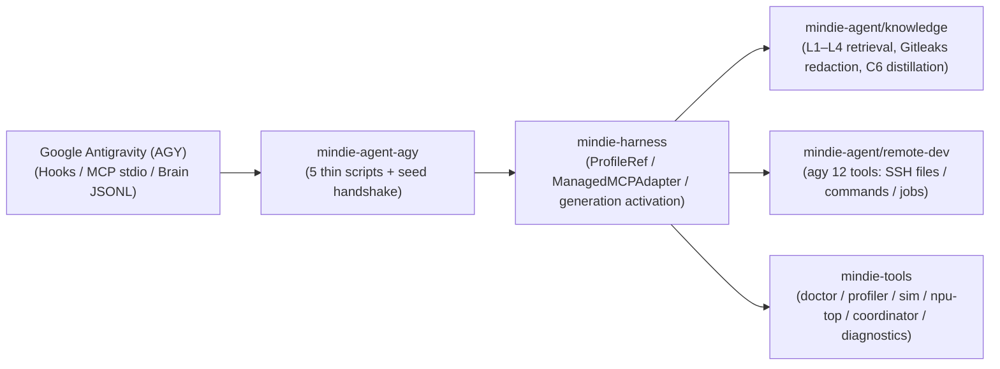

<p align="center">
  
</p>

<h1 align="center">MindIE Agent for Google Antigravity (AGY)</h1>

<p align="center">
  <b>Native Google Antigravity plugin for the full Ascend NPU AI Infra design, development, and validation lifecycle</b><br/>
  <sub>Architecture design · feature development · AscendC / Triton kernels · remote NPU validation · silent engineering capture</sub>
</p>

<p align="center">
  <a href="https://github.com/mindie-agent/mindie-agent-agy/releases"></a>
  <a href="harness-compatibility.json"></a>
  <a href="pyproject.toml"></a>
  <a href="LICENSE"></a>
</p>

<p align="center">
  <a href="README.md">中文</a> | <b>English</b> ·
  <a href="#quick-start-one-sentence-agent-install">Quick Start</a> ·
  <a href="#what-you-get-triggers-and-examples">Use Cases</a> ·
  <a href="#daily-use-and-control-plane-silent-by-default">Daily Use</a> ·
  <a href="#architecture-and-component-boundaries">Architecture</a> ·
  <a href="docs/README.en.md">Documentation</a>
</p>

---

**MindIE Agent for Google Antigravity** (`mindie-agent-agy`) is the native Google Antigravity (`agy`) plugin for [MindIE Agent](https://github.com/mindie-agent/mindie-agent). `v0.1.22` is the **Great Subtraction + UX** release: the plugin is now **5 thin scripts** delegating to `mindie-harness` (`v0.1.3` seed) and the shared components; `mindie-remote-dev` uses Antigravity's native **12-tool `agy` profile**, `mindie-tools` adds the read-only **`mindie_doctor`** readiness check, and installation is a single **one-liner**. `gh` is an optional enhancement, **never a blocker**.

The design follows the [MindIE Agent engineering principles](https://github.com/mindie-agent/mindie-agent/blob/main/docs/design-principles.md): every core capability is silently available while the plugin is enabled, no `/` slash command is exposed (`disable-slash-command: true`), and there is no silent degradation or blind retry.

---

## What you get (triggers and examples)

| Capability | Trigger | When to use | How |
| :--- | :--- | :--- | :--- |
| **Knowledge & Skill**<br/>(`knowledge_*` + `mindie-agent` Skill) | **⚡ Available on plugin enable** | Ascend AI Infra design, `vLLM-Ascend` / `xLLM` / `MindIE-SD` development, `AscendC` / `Triton` kernels, unit/accuracy validation, or tuning | **No slash command**: describe the task in natural language; the skill loads by context and calls `knowledge_query` / `knowledge_explain` / `knowledge_distill` |
| **Remote Ascend NPU development**<br/>(`mindie-remote-dev`) | **⚡ Automatic** | Sync code to a remote Ascend server/container, build/test on NPU, inspect `npu-smi`, or follow long logs | Natural language; 12 native tools: `remote_read_file`, `remote_write_file`, `remote_edit_file`, `remote_run_command`, `remote_manage_task`, `remote_find_by_name`, `remote_grep_search`, `remote_list_dir`, `remote_auth`, `remote_probe`, `remote_artifact_pull`, `remote_artifact_push` |
| **Doctor, profiling, simulation & coordination**<br/>(`mindie-tools`) | **⚡ Discoverable by default** | Install/runtime/SSH/NPU readiness is uncertain, or you need `profiler`, `sim`, `coordinator`, `debugger`, `npu_top` | Call `mindie_doctor` (optionally `probe_remote=true`) first for a read-only readiness report, then `mindie_status`, `profiler`, `sim`, `coordinator`, `npu_top`, `diagnostics_status`, `diagnostics_bundle` |
| **Experience capture & community sharing**<br/>(`Stop` + local Gitleaks) | **🔄 Background after explicit consent** | Share valuable architecture, kernel, test, or tuning experience with the open-source knowledge base | Sharing is off by default; after explicit consent, in-scope turns are locally redacted and prepared as knowledge PRs at turn end. When disabled/out of scope, `Stop` returns `{}`, creates zero SQLite, and never returns `{"decision": "continue"}` |

`mindie-tools` exposes the five graded knowledge tools (`knowledge_query`, `knowledge_explain`, `knowledge_feedback`, `knowledge_distill`, `knowledge_sync`) plus deterministic tools including `mindie_doctor`. Each conversation and subagent owns an independent `conversationId` lease scope (`P2.7`: standard MCP calls need zero `_meta` and zero `PreToolUse` binds).

### Scenario 1: Natural-language knowledge and Skill

> ```text
> I need to design and integrate a custom fused operator for a new model in vllm-ascend (Triton / AscendC). Use the knowledge base's design rules and prior experience to propose an implementation plan.
> ```

Antigravity loads the `mindie-agent` skill automatically and calls `knowledge_query` -> `knowledge_explain` against the locally synced `knowledge-vllm-ascend` `L1–L4` corpus.

### Scenario 2: One-step remote NPU connection and validation

> ```text
> Connect to the remote 910B/A3 container, check NPU memory, sync my new kernel and unit test, and run pytest there.
> ```

`mindie-remote-dev` uses the 12-tool `agy` profile; `remote_auth(..., save_default=True, discover=True)` persists and verifies the default SSH endpoint in one step. If any MindIE tool fails, the agent **reports it once and immediately continues with native `ssh`/`scp`** — a tool failure is never a task roadblock.

### Scenario 3: Background capture and one consent switch

> Community sharing is **off by default**. After explicit consent, the saved choice persists across sessions; each in-scope turn reads `transcript_full.jsonl`, keeps public user/assistant messages only (excluding `thinking`, `tool_calls`, and `<ADDITIONAL_METADATA>`), applies deterministic privacy rules plus local Gitleaks, and prepares a knowledge PR. Disable anytime with `setup.py sharing --disable`.

---

<a id="quick-start-one-sentence-agent-install"></a>
## Quick Start (one-sentence Agent install)

Send this sentence to your Antigravity Agent:

```text
Please install https://github.com/mindie-agent/mindie-agent-agy for me.
```

The Agent runs one core command (no `gh`, no manual clone):

```bash
uv run https://github.com/mindie-agent/mindie-agent/releases/latest/download/install.py --host agy
```

<details>
<summary>🤖 <b>AI Agent install and 3-question dynamic onboarding protocol (click to expand)</b></summary>

1. **Run the one-liner**: `uv run https://github.com/mindie-agent/mindie-agent/releases/latest/download/install.py --host agy`. It stages the plugin, bootstraps the `mindie-harness` seed, and initializes the default profile.
2. **`gh` is optional, never a gate**: run `gh api --hostname github.com user --jq .login` with a 3s bound and skip on failure. If authenticated, recommend `contribute`; otherwise recommend `local-only` and continue the install.
3. **Call Antigravity's native `ask_question`** (`is_multi_select: false`, first option prefixed `(Recommended)`; fall back to a numbered card without the tool) for 3 questions:
   - **Workspace**: `(Recommended) Use the current directory` / `Specify an existing workspace`.
   - **Community sharing (dynamic recommendation)**: if `gh` is authenticated, `(Recommended) Enable community sharing & fault reporting (contribute)` / `Local-only (local-only)`; otherwise, `(Recommended) Local-only (local-only)` / `Enable community sharing (contribute)`.
   - **Remote NPU**: `(Recommended) Connect a remote NPU now` / `Later`. On "now", call `remote_auth(host, port, user, password_env, save_default=True, discover=True)`; in terminal mode prompt for `--password` **at the very end** (password goes only into the environment/credential store, never chat or a repository).
4. **Persist the choice**:
   ```bash
   # contribute
   python3 plugins/mindie-agent/scripts/setup.py sharing --enable --project-root "$WORKSPACE_ROOT"
   # local-only
   python3 plugins/mindie-agent/scripts/setup.py sharing --local-only --project-root "$WORKSPACE_ROOT"
   ```
5. **`mindie_doctor` readiness check**: call `mindie_doctor` (optionally `{"probe_remote": true}`) for local/runtime/SSH readiness. On failure, report once and continue; never block the install.
6. **Star postscript (one polite line, never required)**: if this project helps you, a GitHub Star ⭐ is appreciated: <https://github.com/mindie-agent/mindie-agent>.

</details>

> The installer never mutates the host `~/.gemini`; MindIE configuration goes to `MINDIE_CONFIG_HOME` / `MINDIE_DATA_HOME` (defaults: `~/.config/mindie-agent` and `~/.local/share/mindie-agent`).

---

## Daily use and control plane (silent by default)

| Scenario | What you do | What happens automatically |
|---|---|---|
| **Everyday Ascend design, development (`vLLM-Ascend` / `AscendC` / `Triton`), testing, tuning** | **No prefix command**; describe the task | Antigravity loads the `mindie-agent` skill by context and calls `mindie-tools` / `mindie-remote-dev` |
| **Install/runtime/SSH/NPU readiness is uncertain** | Ask the Agent to call `mindie_doctor` | Read-only local/runtime/profile/SSH/dependency facts; no knowledge loop, no diagnostics upload |
| **One-step remote NPU connection** | Ask the Agent to call `remote_auth(..., save_default=True, discover=True)` | Verifies/persists the default endpoint; terminal-mode password is requested last and stays in the environment/credential store |
| **Inspect the control plane and consent** | Ask the Agent to call `mindie_status` or `setup.py sharing --status` | Read-only session/profile/sharing/diagnostics facts |
| **Change community sharing** | `setup.py sharing --enable` / `--local-only` / `--disable` | Updates `mindie-consent.json` and `mindie-community.json`; persists across sessions |

---

## Architecture and component boundaries

`mindie-agent-agy v0.1.22` is a **thin adapter**: this repository keeps only 5 production scripts (`mindie_launch.py`, `bridge.py`, `mcp_server.py`, `agy_transcript.py`, `setup.py`). Lifecycle, runtime generations, the MCP gateway, sharing consent, and knowledge RPC are delegated to `mindie-harness` and the shared components.



| Repository / component | Responsibility |
|---|---|
| `mindie-agent/mindie-agent-agy` (this repo) | 5-script thin plugin, frozen `hooks.json`, `mcp_config.json`, `agy` 12-tool profile, `transcript_full.jsonl` public-message parsing, and `mindie_doctor` exposure. |
| [`mindie-agent/harness`](https://github.com/mindie-agent/harness) | `ProfileRef`, `ManagedMCPAdapter`, generation build/activate/GC, sharing consent, wheelhouse updates, and `mindie-harness-seed.pyz` cold bootstrap. |
| [`mindie-agent/knowledge`](https://github.com/mindie-agent/knowledge) | `L1–L4` graded retrieval, deterministic redaction, capture queue, C6 distillation, and GitHub PR reconciliation. |
| [`mindie-agent/remote-dev`](https://github.com/mindie-agent/remote-dev) | Remote Ascend SSH file read/write, patch sync, managed background jobs, and native `agy` 12-tool mapping. |
| [`mindie-agent/profiler`](https://github.com/mindie-agent/profiler) / [`sim`](https://github.com/mindie-agent/sim) / [`npu-top`](https://github.com/mindie-agent/npu-top) / [`coordinator`](https://github.com/mindie-agent/coordinator) / [`diagnostics`](https://github.com/mindie-agent/diagnostics) | Profiling, Roofline simulation, NPU dashboard, hardware probe/lease coordination, and sanitized diagnostics. |

### Local directories

- **Adapter config**: `${MINDIE_CONFIG_HOME:-$HOME/.config/mindie-agent}/agy.json` (interpreter, scripts, engine config path).
- **Engine and sharing**: `agy.engine.json`, `mindie-community.json`, `mindie-consent.json` in the same directory.
- **State**: `${MINDIE_DATA_HOME:-$HOME/.local/share/mindie-agent}/state/agy/` (`admission.sqlite3`, `pending-update-check.json`, `remote/`).

---

## Developer verification and tests

```bash
python3 .github/scripts/check_lf_eol.py
shasum -a 256 plugins/mindie-agent/hooks.json   # 979 bytes / 33b564c7...
wc -l plugins/mindie-agent/scripts/*.py         # <= 1200 total
pytest -q -m "not live_npu"
```

Coverage: frozen hooks/MCP config, seed verification, compatibility AST resolution, cold/disabled/out-of-scope Stop, `local-only` / `contribute` capture with explicit revocation, 12-tool remote catalogs, zero-`_meta` knowledge reads with Receipt Honesty, read-only `setup --dry-run`, sharing tiers, and harness generation activation/rebinding.

---

## Documentation

- **[Documentation Index (English)](docs/README.en.md)** | **[文档索引（中文）](docs/README.md)**
- **Harness interfaces and evidence**: [English](docs/harness-interfaces.md) | [中文](docs/harness-interfaces.zh.md)
- **Public transcript capture and redaction**: [English](docs/public-transcript.md) | [中文](docs/public-transcript.zh.md)
- **Service identity and consent continuity**: [English](docs/service-continuity.md) | [中文](docs/service-continuity.zh.md)
- **Failure diagnostics, timeout arithmetic, and Receipt Honesty**: [English](docs/failure-diagnostics.md) | [中文](docs/failure-diagnostics.zh.md)
- **Framework stability and persistent configuration**: [English](docs/framework-stability.md) | [中文](docs/framework-stability.zh.md)
- **Test boundaries and contracts**: [English](docs/testing-contracts.md) | [中文](docs/testing-contracts.zh.md)

---

## License

Released under the [MIT License](LICENSE).
