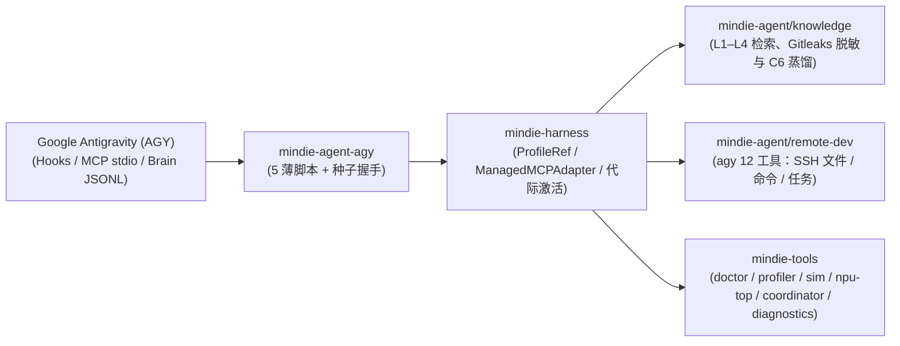

<p align="center">
  
</p>

<h1 align="center">MindIE Agent for Google Antigravity (AGY)</h1>

<p align="center">
  <b>面向昇腾（Ascend）NPU AI Infra 研发、设计与测试全流程的 Google Antigravity 原生插件</b><br/>
  <sub>覆盖架构设计 · 特性开发 · AscendC / Triton 算子实现 · 远端 NPU 测试验证 · 研发经验静默沉淀</sub>
</p>

<p align="center">
  <a href="https://github.com/mindie-agent/mindie-agent-agy/releases"></a>
  <a href="harness-compatibility.json"></a>
  <a href="pyproject.toml"></a>
  <a href="LICENSE"></a>
</p>

<p align="center">
  <b>中文</b> | <a href="README.en.md">English</a> ·
  <a href="#快速开始交给-agent-一句话自动安装">快速开始</a> ·
  <a href="#装上之后能做什么触发方式与使用示例">应用场景</a> ·
  <a href="#日常使用与控制面操作默认全静默运行">日常使用</a> ·
  <a href="#架构与组件边界">系统架构</a> ·
  <a href="docs/README.md">技术文档</a>
</p>

---

**MindIE Agent for Google Antigravity**（`mindie-agent-agy`）是 [MindIE Agent](https://github.com/mindie-agent/mindie-agent) 面向 Google Antigravity（`agy`）的原生插件。`v0.1.22` 是**大减法（Great Subtraction）+ UX 升级**版本：插件收敛为 **5 个薄脚本**，全面委托 `mindie-harness`（`v0.1.3` 种子包）与共享组件；`mindie-remote-dev` 直接启用 Antigravity 原生 **12 工具 `agy` Profile**，`mindie-tools` 新增 **`mindie_doctor`** 只读就绪检查；安装收敛为**一句话 one-liner**，`gh` 仅作可选增强，**绝不阻塞**。

项目设计严格遵循 [MindIE Agent 工程设计原则](https://github.com/mindie-agent/mindie-agent/blob/main/docs/design-principles.md)：插件启用后全部核心能力默认静默可用，不暴露 `/` 斜杠命令（`SKILL.md` 启用 `disable-slash-command: true`），不做静默降级或盲目重试。

---

## 装上之后能做什么？（触发方式与使用示例）

| 能力模块 | 触发方式 | 什么时候用？ | 怎么用？ |
| :--- | :--- | :--- | :--- |
| **知识库与 Skill 系统**<br/>（`knowledge_*` + `mindie-agent` Skill） | **⚡ 插件启用即静默可用** | 开展昇腾 AI Infra 设计、`vLLM-Ascend` / `xLLM` / `MindIE-SD` 开发、`AscendC` / `Triton` 算子实现、单测/精度验证或性能调优时 | **无需任何斜杠命令**，用自然语言描述需求即可自动加载 Skill 并调用 `knowledge_query` / `knowledge_explain` / `knowledge_distill` |
| **远端昇腾 NPU 开发与测试**<br/>（`mindie-remote-dev`） | **⚡ 默认自动触发** | 同步代码到远端昇腾服务器/容器、在 NPU 上编译/测试、查看 `npu-smi` 或长日志 | 自然语言直接描述远端操作；12 个原生工具：`remote_read_file`、`remote_write_file`、`remote_edit_file`、`remote_run_command`、`remote_manage_task`、`remote_find_by_name`、`remote_grep_search`、`remote_list_dir`、`remote_auth`、`remote_probe`、`remote_artifact_pull`、`remote_artifact_push` |
| **诊断、Profiling、仿真与资源协调**<br/>（`mindie-tools`） | **⚡ 默认可发现** | 安装/运行时/SSH/NPU 就绪性不确定，或需要 `profiler`、`sim`、`coordinator`、`debugger`、`npu_top` | 先调用 `mindie_doctor`（可选 `probe_remote=true`）做只读就绪检查，再按需调用 `mindie_status`、`profiler`、`sim`、`coordinator`、`npu_top`、`diagnostics_status`、`diagnostics_bundle` |
| **研发经验沉淀与社区共建**<br/>（`Stop` 后台采集 + Gitleaks 脱敏） | **🔄 开启共享授权后默认后台运行** | 希望将有价值的架构、算子、测试或调优经验脱敏沉淀回开源知识库时 | 社区共享默认关闭；显式开启后，授权工作区内回合结束自动完成本地 Gitleaks 脱敏与知识 PR 整理；未开启或不在授权范围时 `Stop` 返回 `{}`，不创建 SQLite，绝不返回 `{"decision": "continue"}` |

`mindie-tools` 默认公开 `knowledge_query`、`knowledge_explain`、`knowledge_feedback`、`knowledge_distill`、`knowledge_sync` 五个分级知识工具，以及 `mindie_doctor` 等确定性工具。每个会话与子代理拥有独立 `conversationId` 租约作用域（`P2.7`：标准 MCP 调用零 `_meta`、零 `PreToolUse` 绑定）。

### 场景 1：自然语言直接唤醒知识库与 Skill

> ```text
> 我准备在 vllm-ascend 中为新模型设计并接入一个自定义融合算子（支持 Triton / AscendC），请结合知识库里的设计规范和开发经验帮我制定实现方案。
> ```

Antigravity 自动匹配 `mindie-agent` Skill，并通过 `knowledge_query` -> `knowledge_explain` 检索本地已同步的 `knowledge-vllm-ascend` 等 `L1–L4` 分级知识包。

### 场景 2：一句话连接远端 NPU 并跑通验证

> ```text
> 帮我连上远端 910B/A3 容器，看看 NPU 显存占用，然后把我本地新写的算子和单测同步过去跑一遍 pytest。
> ```

内置 `mindie-remote-dev` 使用 `agy` 12 工具 Profile；`remote_auth(..., save_default=True, discover=True)` 一步保存并验证默认 SSH 端点。若任何 MindIE 工具失败，Agent 会**报告一次并立即改用原生 `ssh`/`scp` 继续任务**，绝不把工具故障变成任务路障。

### 场景 3：研发经验后台沉淀与统一贡献开关

> 社区贡献**默认关闭**。显式开启后，保存的授权配置跨会话持久生效；授权工作区内每次回合结束自动定位 `transcript_full.jsonl`，提取公开用户/助手消息（严格剔除 `thinking`、`tool_calls` 与 `<ADDITIONAL_METADATA>`），使用确定性隐私规则与 Gitleaks 本地脱敏并整理知识 PR。可随时通过 `setup.py sharing --disable` 停用采集。

---

<a id="快速开始交给-agent-一句话自动安装"></a>
## 快速开始（交给 Agent 一句话自动安装）

直接复制下面这句话发送给你的 Antigravity Agent：

```text
帮我安装一下这个 https://github.com/mindie-agent/mindie-agent-agy
```

Agent 执行的核心命令只有一条（无需 `gh`，无需手动克隆）：

```bash
uv run https://github.com/mindie-agent/mindie-agent/releases/latest/download/install.py --host agy
```

<details>
<summary>🤖 <b>AI Agent 自动安装与 3 问动态 Onboarding 协议（点击展开）</b></summary>

1. **执行 one-liner**：`uv run https://github.com/mindie-agent/mindie-agent/releases/latest/download/install.py --host agy`。安装器负责插件落盘、`mindie-harness` 种子自举与默认 Profile 初始化。
2. **`gh` 是可选增强，绝不是门禁**：先执行 `gh api --hostname github.com user --jq .login`（超时 3s，可跳过）。已登录时推荐 `contribute`；未安装/未登录时推荐 `local-only`，安装继续。
3. **立即调用 Antigravity 原生 `ask_question`**（`is_multi_select: false`，首项带 `(Recommended)`；无该工具时输出编号单选卡片）一次性询问 3 个问题：
   - **工作区**：`(Recommended) 使用当前目录` / `指定已有工作区目录`。
   - **社区共享**（动态推荐）：若 `gh` 已登录，`(Recommended) 开启社区共享与故障上报（contribute）` / `仅本地模式（local-only）`；否则，`(Recommended) 仅本地模式（local-only）` / `开启社区共享与故障上报（contribute）`。
   - **远端 NPU**：`(Recommended) 现在一步连接远端 NPU` / `稍后连接`。选择现在时调用 `remote_auth(host, port, user, password_env, save_default=True, discover=True)`；终端模式下在**流程最后**提示用户输入 `--password`（密码只进环境变量/凭据库，绝不写入聊天或仓库）。
4. **落盘选择**：
   ```bash
   # contribute
   python3 plugins/mindie-agent/scripts/setup.py sharing --enable --project-root "$WORKSPACE_ROOT"
   # local-only
   python3 plugins/mindie-agent/scripts/setup.py sharing --local-only --project-root "$WORKSPACE_ROOT"
   ```
5. **`mindie_doctor` 就绪检查**：让 Agent 调用 `mindie_doctor`（可选 `{"probe_remote": true}`）确认本地/运行时/SSH 就绪；失败只报告一次并继续，不阻塞安装。
6. **Star 后记（单行、礼貌、绝不强求）**：如果这个项目帮到了你，欢迎在 GitHub 点一个 Star ⭐：<https://github.com/mindie-agent/mindie-agent>。

</details>

> 安装器绝不修改宿主 `~/.gemini`；所有 MindIE 配置写入 `MINDIE_CONFIG_HOME` / `MINDIE_DATA_HOME`（默认 `~/.config/mindie-agent` 与 `~/.local/share/mindie-agent`）。

---

## 日常使用与控制面操作（默认全静默运行）

| 使用场景 | 你只需要做什么 | 背后自动完成的事 |
|---|---|---|
| **日常昇腾设计、开发（`vLLM-Ascend` / `AscendC` / `Triton`）、测试与调优** | **无需任何前置命令**，直接描述需求 | Antigravity 按任务上下文自动加载 `mindie-agent` Skill，调用 `mindie-tools` 与 `mindie-remote-dev` 完成验证 |
| **安装/运行时/SSH/NPU 就绪性不确定** | 让 Agent 调用 `mindie_doctor` | 只读返回本地、运行时、Profile、SSH 与依赖就绪事实，不启动知识循环、不上传诊断 |
| **一步连接远端 NPU** | 让 Agent 调用 `remote_auth(..., save_default=True, discover=True)` | 验证/保存默认端点；终端模式密码在最后一步输入，仅进环境变量/凭据库 |
| **查看当前会话控制面与授权状态** | 让 Agent 调用 `mindie_status` 或 `setup.py sharing --status` | 只读返回会话、Profile、共享授权与诊断健康事实 |
| **调整社区经验共享偏好** | `setup.py sharing --enable` / `--local-only` / `--disable` | 更新 `mindie-consent.json` 与 `mindie-community.json`，跨会话持久生效 |

---

## 架构与组件边界

`mindie-agent-agy v0.1.22` 是**薄适配层（Thin Adapter）**：本仓库仅保留 5 个生产脚本（`mindie_launch.py`、`bridge.py`、`mcp_server.py`、`agy_transcript.py`、`setup.py`），生命周期、运行时代际、MCP 网关、共享授权与知识 RPC 全部委托 `mindie-harness` 与共享组件。



| 仓库 / 组件 | 核心职责 |
|---|---|
| `mindie-agent/mindie-agent-agy`（本仓库） | 5 脚本薄插件、冻结 `hooks.json`、`mcp_config.json`、`agy` 12 工具 Profile、`transcript_full.jsonl` 公开消息解析与 `mindie_doctor` 暴露。 |
| [`mindie-agent/harness`](https://github.com/mindie-agent/harness) | `ProfileRef`、`ManagedMCPAdapter`、代际构建/激活/GC、共享授权、wheelhouse 更新与 `mindie-harness-seed.pyz` 冷启动。 |
| [`mindie-agent/knowledge`](https://github.com/mindie-agent/knowledge) | `L1–L4` 分级检索、确定性脱敏、采集队列、C6 经验蒸馏与 GitHub PR 发布对账。 |
| [`mindie-agent/remote-dev`](https://github.com/mindie-agent/remote-dev) | 远端昇腾 SSH 文件读写、补丁同步、受管后台作业与原生 `agy` 12 工具映射。 |
| [`mindie-agent/profiler`](https://github.com/mindie-agent/profiler) / [`sim`](https://github.com/mindie-agent/sim) / [`npu-top`](https://github.com/mindie-agent/npu-top) / [`coordinator`](https://github.com/mindie-agent/coordinator) / [`diagnostics`](https://github.com/mindie-agent/diagnostics) | 性能采集、Roofline 仿真、NPU 看板、硬件探针/租约协调与脱敏诊断。 |

### 本地目录说明

- **适配器配置**：`${MINDIE_CONFIG_HOME:-$HOME/.config/mindie-agent}/agy.json`（解释器、脚本目录、引擎配置路径）。
- **引擎与共享配置**：同目录下 `agy.engine.json`、`mindie-community.json`、`mindie-consent.json`。
- **状态**：`${MINDIE_DATA_HOME:-$HOME/.local/share/mindie-agent}/state/agy/`（`admission.sqlite3`、`pending-update-check.json`、`remote/`）。

---

## 开发者验证与测试

```bash
python3 .github/scripts/check_lf_eol.py
shasum -a 256 plugins/mindie-agent/hooks.json   # 979 bytes / 33b564c7...
wc -l plugins/mindie-agent/scripts/*.py         # <= 1200 total
pytest -q -m "not live_npu"
```

测试覆盖：冻结 hooks/MCP 配置、种子校验、兼容性 AST 解析、冷/禁用/范围外 `Stop`、`local-only` / `contribute` 捕获与显式撤销、12 工具 remote catalog、零 `_meta` 知识读取与 Receipt Honesty、`setup --dry-run` 只读保证、共享层级与 harness 代际激活/重绑定。

---

## 文档导航

- **[文档索引（中文）](docs/README.md)** | **[Documentation Index (English)](docs/README.en.md)**
- **Harness 接口与验证证据**：[中文](docs/harness-interfaces.zh.md) | [English](docs/harness-interfaces.md)
- **公开对话采集与本地脱敏**：[中文](docs/public-transcript.zh.md) | [English](docs/public-transcript.md)
- **服务身份与统一授权连续性**：[中文](docs/service-continuity.zh.md) | [English](docs/service-continuity.md)
- **故障诊断、超时算术与回执诚实性**：[中文](docs/failure-diagnostics.zh.md) | [English](docs/failure-diagnostics.md)
- **框架稳定性与持久化配置**：[中文](docs/framework-stability.zh.md) | [English](docs/framework-stability.md)
- **测试边界与契约校验**：[中文](docs/testing-contracts.zh.md) | [English](docs/testing-contracts.md)

---

## 许可证

本项目基于 [MIT License](LICENSE) 开源。
