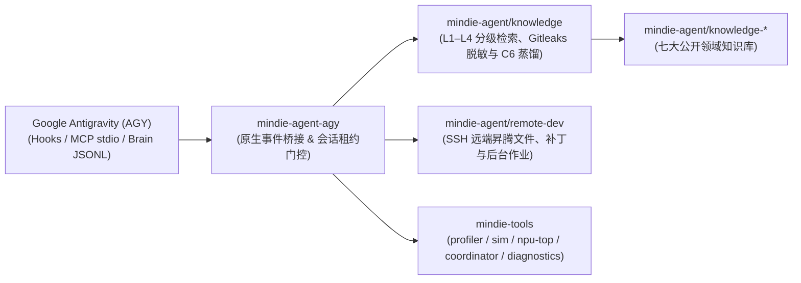

<p align="center">
  
</p>

<h1 align="center">MindIE Agent for Google Antigravity (AGY)</h1>

<p align="center">
  <b>面向昇腾（Ascend）NPU AI Infra 研发、设计与测试全流程的 Google Antigravity 原生插件</b><br/>
  <sub>覆盖架构设计 · 特性开发 · AscendC / Triton 算子实现 · 远端 NPU 测试验证 · 研发经验静默沉淀</sub>
</p>

<p align="center">
  <a href="https://github.com/mindie-agent/mindie-agent-agy/releases"></a>
  <a href="harness-compatibility.json"></a>
  <a href="pyproject.toml"></a>
  <a href="LICENSE"></a>
</p>

<p align="center">
  <b>中文</b> | <a href="README.en.md">English</a> ·
  <a href="#快速开始">快速开始</a> ·
  <a href="#装上之后能做什么触发方式与使用示例">应用场景</a> ·
  <a href="#日常使用与管理命令统一入口-mindie-agent">命令参考</a> ·
  <a href="#架构与组件边界">系统架构</a> ·
  <a href="docs/README.md">技术文档</a>
</p>

---

**MindIE Agent for Google Antigravity**（`mindie-agent-agy`）是 [MindIE Agent](https://github.com/mindie-agent/mindie-agent) 面向 Google Antigravity（`agy`）的原生插件，服务于**昇腾（Ascend）NPU 上的 AI Infra 设计、开发与测试全流程**。当前 `v0.1.0` 已交付三大核心能力：**本地与社区知识库检索及隐私脱敏**（优先覆盖 `vLLM-Ascend` 特性开发与 `AscendC` / `Triton` 算子工程）、**远端 SSH / Docker 开发与 NPU 状态巡检**，以及**统一故障诊断与脱敏上报**；更多昇腾基础软件领域将随演进路线图持续扩展。

项目设计严格遵循 [MindIE Agent 工程设计原则](https://github.com/mindie-agent/mindie-agent/blob/main/docs/design-principles.md)：**领域知识与 Skill 体系通过 `/mindie-agent` 手动按需唤醒**，不干扰非昇腾常规任务；**`mindie-remote-dev` 远端昇腾开发与测试工具默认常驻自动触发**；所有状态与报错真实可定位，遵守回执诚实性（Receipt Honesty）与超时算术不变量，不做静默降级或盲目重试。

---

## 装上之后能做什么？（触发方式与使用示例）

MindIE Agent 采用**「领域知识与 Skill 手动按需触发 + 远端开发测试工具默认常驻触发」**的设计：

| 能力模块 | 触发方式 | 什么时候用？ | 怎么用？ |
| :--- | :--- | :--- | :--- |
| **经验、知识库与 Skill 系统**<br/>（`mindie-knowledge` + `mindie-agent` Skill） | **🎯 当前会话手动触发** | 开展昇腾 AI Infra 架构设计、`vLLM-Ascend` 特性开发、`AscendC` / `Triton` 算子实现、单测/精度测试构建、性能调优或问题定位时 | 在当前会话中显式输入一次 **`/mindie-agent` + 你的需求描述**，即可在本会话后续轮次持续启用知识检索、反馈、蒸馏与同步（输入 `/mindie-agent deactivate` 可在当前会话关闭） |
| **远端昇腾 NPU 开发与测试**<br/>（`mindie-remote-dev` MCP 工具集） | **⚡ 默认自动触发** | 日常需要将本地代码或测试同步到远端昇腾服务器/容器、在 NPU 上跑编译/测试、查看 `npu-smi` 或实时轮询长日志时 | **无需输入 `/mindie-agent`**，直接用自然语言描述远端操作即可 |
| **Profiling、仿真、资源协调与本地诊断**<br/>（`mindie-tools` MCP 工具集） | **默认可发现** | 调用已安装的 `profiler`、`sim`、`coordinator`，或查看本地 `diagnostics`、导出诊断包 | 直接调用 `mindie_status`、`profiler`、`sim`、`coordinator`、`diagnostics_status`、`diagnostics_bundle`；无需启用知识租约 |
| **研发经验沉淀与社区共建**<br/>（`Stop` 后台采集 + Gitleaks 脱敏） | **🔄 已启用会话后台自动运行** | 希望将有价值的架构设计、算子开发、测试验证或调优经验脱敏沉淀回开源知识库时 | **授权一次配置，按会话生效**——首次配置开启社区贡献后，在已通过 `/mindie-agent` 启用知识系统的会话中，每次回合结束自动在后台完成本地脱敏与知识 PR 整理；未调用 `/mindie-agent` 的普通会话不触发后台采集 |

默认公开 MCP 工具目录（`mindie-remote-dev` 与 `mindie-tools`）不含任何 `knowledge_*` 工具的名称、描述和参数。当用户通过 `/mindie-agent` 手动启用当前 Antigravity 会话（`conversationId`）后，`PreInvocation` Hook 在 `admission.sqlite3` 登记会话租约，Skill 通过受门控的私有 [`knowledge_cli.py`](plugins/mindie-agent/scripts/knowledge_cli.py) 调用本地知识引擎；子代理（Subagent）拥有独立的 `conversationId`，天然隔离且不会继承父会话的知识租约。

### 场景 1：输入 `/mindie-agent` 唤醒知识库与 Skill 辅助设计、开发与测试（手动触发）
> **痛点**：在昇腾上设计新特性、开发 `AscendC` / `Triton` 算子或编写 `vLLM-Ascend` 测试时，在海量文档和 Issue 里翻找架构规范、算子约束与适用条件非常耗时。  
> **用法示例（直接复制发给 Antigravity）**：
> ```text
> /mindie-agent 我准备在 vllm-ascend 中为新模型设计并接入一个自定义融合算子（支持 Triton / AscendC 实现）并补齐单元与精度测试，请结合知识库里的现有设计规范和开发经验帮我制定实现方案。
> ```
> **会发生什么**：输入 `/mindie-agent` 后，`PreInvocation` Hook 激活当前 `conversationId` 的会话租约并注入临时引导步骤，唤醒 `mindie-agent` Skill，通过本地 BM25 与分块引用检索自动同步的 [`knowledge-vllm-ascend`](https://github.com/mindie-agent/knowledge-vllm-ascend) 知识包，返回带有**适用版本、验证证据和已知限制**的实战参考。

### 场景 2：日常对话直接操作远端昇腾 NPU 服务器与容器（`mindie-remote-dev` 默认自动触发）
> **痛点**：本地是 Windows 或 macOS 开发机，而昇腾 NPU 卡在远端服务器或容器上，频繁手动拷贝代码、编译算子、盯长耗时测试日志非常繁琐。  
> **用法示例（无需激活命令，直接用自然语言发给 Antigravity）**：
> ```text
> 帮我连上远端 910B/A3 服务器的开发容器，看看当前 NPU 显存占用，然后把我本地新写的算子实现和 rotary_embedding 单测同步过去跑一下完整的 pytest 验证。
> ```
> **会发生什么**：内置的 `mindie-remote-dev` 工具集作为常驻 stdio MCP 服务，同时支持规范名（`remote_read`、`remote_write`、`remote_edit`、`remote_bash`、`remote_job` 等）与 Antigravity 原生别名（`remote_view_file`、`remote_write_to_file`、`remote_replace_file_content`、`remote_run_command`、`remote_manage_task` 等），在识别到远端开发意图时**默认自动触发**。即使不开启知识贡献，`mindie-remote-dev` 也能完全独立运行。

### 场景 3：研发经验后台沉淀与统一贡献开关（一次配置，无日常额外操作）
> **痛点**：完成了一项复杂的特性设计、算子实现或深度调优后，关掉窗口经验就丢了；想分享给社区又担心泄露内部 IP、密钥、思维链（`thinking`）或私有路径。  
> **用法示例（像平时一样正常开展研发与测试即可）**：
> ```text
> /mindie-agent 帮我结合知识库和远端 NPU 容器完成当前 vllm-ascend 自定义算子的编译与精度对齐验证，并跑通对应的单测。
> ```
> **会发生什么**：社区贡献**默认关闭**。当你显式开启社区贡献后，保存的授权配置会跨会话持久生效；在任何通过 `/mindie-agent` 启用了知识系统的会话中，每次回合结束（`Stop`）时，插件都会在后台自动定位 `<appDataDir>/brain/<conversationId>/.system_generated/logs/transcript_full.jsonl`，提取该会话自激活起的公开用户/助手消息（严格剔除 `thinking` 内部思维链、`tool_calls` 工具参数/输出以及 `<ADDITIONAL_METADATA>` 系统包装标签），使用确定性隐私规则与 Gitleaks 在本地完成脱敏，生成分块导航摘要并提交知识 PR（未调用 `/mindie-agent` 的普通会话在 `Stop` 阶段直接返回 `{}` 短路跳过，不读取对话或配置，且绝不返回 `{"decision": "continue"}` 干扰正常结束）。
> - **统一贡献开关（`~/.config/mindie-agent/mindie-consent.json`）**：社区知识贡献与自动工具故障上报共用同一个持久化开关（`mindie-consent/1`）与共享设置（`mindie-community-config/1`）。
> - 关于公开消息筛选范围、确定性脱敏边界与公开 Git 历史说明，请参阅 **[用户须知 / Contribution Notice](plugins/mindie-agent/skills/mindie-agent/references/user-notice.md)**。
> - 如需在本地搭建 `vllm` + `vllm-ascend` 多任务 Git Worktree 协同工作区，可按需参考 **[工作区配置指南](plugins/mindie-agent/skills/mindie-agent/references/workspace-setup.md)** 与 [vllm-ascend-workspace](https://github.com/mindie-agent/vllm-ascend-workspace)。

---

## 快速开始（交给 Agent 一句话自动安装）

直接复制下面这句话发送给你的 Antigravity Agent，由其自动完成环境检查、插件部署与初始化：

```text
帮我安装一下这个 https://github.com/mindie-agent/mindie-agent-agy
```

<details>
<summary>🤖 <b>AI Agent 自动安装执行协议（点击展开 / Agent 读取本页时会自动解析执行）</b></summary>

如果你是收到用户安装请求的 AI Agent，请直接按顺序在终端执行以下步骤完成安装与核验，**无需让用户手动翻阅文档**：

1. **检查基础工具与 `gh` GitHub 交互通道（硬性指标）**：
   **稳定的 GitHub 交互通道（已安装并登录 `gh` CLI）是硬性前置指标**——插件拉取、`knowledge-vllm-ascend` 同步、经验闭环自动提交 PR 及组件故障上报均依赖该通道：
   ```sh
   git --version
   uv --version
   gh --version
   GH_USER=$(gh api --hostname github.com user --jq .login) && echo "GitHub channel verified for account: $GH_USER"
   gh auth setup-git --hostname github.com
   ```
   - **硬性门禁（严禁跳过或静默忽略）**：若未安装 `gh` 或未登录，请按 [GitHub 登录引导](plugins/mindie-agent/skills/mindie-agent/references/github-authentication.md) 协助完成认证。

2. **克隆 `mindie-agent-agy` 并将原生插件包安装到用户全局或当前工作区插件目录**：
   - **工作区级安装**（推荐用于项目隔离，挂载到 `<workspace>/.agents/plugins/mindie-agent`）：
     ```sh
     git clone https://github.com/mindie-agent/mindie-agent-agy.git
     mkdir -p .agents/plugins
     cp -R mindie-agent-agy/plugins/mindie-agent .agents/plugins/mindie-agent
     ```
   - **用户全局安装**（挂载到 `~/.gemini/plugins/mindie-agent`）：
     ```sh
     git clone https://github.com/mindie-agent/mindie-agent-agy.git
     mkdir -p ~/.gemini/plugins
     cp -R mindie-agent-agy/plugins/mindie-agent ~/.gemini/plugins/mindie-agent
     ```

3. **初始化适配器默认 Profile（被动静默模式，不自动启动知识守护进程）**：
   ```sh
   python .agents/plugins/mindie-agent/scripts/setup.py init --workspace-root "$PWD"
   ```

4. **核对插件安装与契约测试**：
   ```sh
   pytest mindie-agent-agy/tests -q
   ```
   - 向用户汇报已验证的 GitHub 账号（`$GH_USER`）、插件挂载路径以及默认 Profile（`~/.config/mindie-agent/agy.json`）初始化状态。
   - 随后介绍 [用户须知](plugins/mindie-agent/skills/mindie-agent/references/user-notice.md) 与 [工作区配置指南](plugins/mindie-agent/skills/mindie-agent/references/workspace-setup.md)，并提示用户输入 **`/mindie-agent 帮我完成首次配置`** 即可启用领域知识与 Skill 引导。

</details>

---

## 日常使用与管理命令（统一入口 `/mindie-agent`）

MindIE Agent 将交互能力收敛在 **`/mindie-agent` 这一统一入口**中。日常使用无需记忆复杂的子命令或脚本参数，底层操作上下文仅在需要时通过**渐进式披露（Progressive Disclosure）**按需向 Agent 展开：

| 使用场景 | 你只需要输入 | 背后自动完成的事 |
|---|---|---|
| **日常昇腾 AI Infra 设计、开发（`vLLM-Ascend` / `AscendC` / `Triton`）、测试与调优** | `/mindie-agent <直接描述你的设计、开发或测试需求>` | `PreInvocation` Hook 激活当前 `conversationId` 租约，唤醒昇腾 Skill 引导与私有 `knowledge_cli.py` 领域知识检索，配合 `mindie-remote-dev` 完成实机开发、验证与调优 |
| **首次配置、查看状态或调整社区经验共享偏好** | `/mindie-agent` 加自然语言（例如 `/mindie-agent 看下当前状态`、`/mindie-agent 开启/关闭社区经验共享`） | Agent 按需读取二级参考上下文并调用 `setup.py` / `knowledge_cli.py` 完成操作，保存的选择跨会话持久生效 |
| **停止当前会话的知识租约** | `/mindie-agent deactivate` | 立即撤销当前 `conversationId` 在 `admission.sqlite3` 中的租约，后续回合不再允许调用私有知识接口或触发 `Stop` 采集 |
| **日常远端昇腾服务器/容器开发** | **无需任何前置命令**，直接用自然语言对话 | 常驻的 `mindie-remote-dev` MCP 工具集默认自动触发，完成远端文件读写、打补丁与后台作业轮询 |

---

## 架构与组件边界

`mindie-agent-agy` 采用**薄适配层（Thin Adapter）**架构：本仓库仅负责对接 Google Antigravity 原生插件清单（`plugin.json`、插件根目录 `hooks.json`、`mcp_config.json`）、CamelCase `protojson` Hook 事件桥接、Brain `transcript_full.jsonl` 公开对话提取与会话级租约门控；核心知识引擎、远端昇腾执行与故障诊断均由独立的共享组件承载。



| 仓库 / 组件 | 核心职责 |
|---|---|
| [`mindie-agent/mindie-agent`](https://github.com/mindie-agent/mindie-agent) | 顶层架构、MindIE Agent 工程设计原则、领域边界与配套发布规范。 |
| `mindie-agent/mindie-agent-agy`（本仓库） | Google Antigravity 原生插件包（`plugins/mindie-agent/`）、`PreInvocation` 手动会话激活门控、`PreToolUse` 单次调用绑定、`transcript_full.jsonl` 公开对话解析与隔离摘要/蒸馏 Worker。 |
| [`mindie-agent/knowledge`](https://github.com/mindie-agent/knowledge) | 共享知识核心：`L1–L4` 分级检索、确定性脱敏、采集队列、C6 自动经验蒸馏与 GitHub PR 发布对账。 |
| [`mindie-agent/remote-dev`](https://github.com/mindie-agent/remote-dev) | 面向远端昇腾服务器的 SSH 文件读写、补丁同步、受管后台作业与实时日志流（原生内置 Antigravity 工具与参数别名映射）。 |
| [`mindie-agent/profiler`](https://github.com/mindie-agent/profiler) | 昇腾 NPU 性能采集、算子/通信拆解与跨次对比 CLI（`mindie-profiler`）。 |
| [`mindie-agent/sim`](https://github.com/mindie-agent/sim) | 昇腾 A2/A3/A5 四层白盒性能仿真与 Roofline 理论边界求解器（`mindie-sim`，支持 TP/DP/EP/PP/CP/DCP/SP 七维并行）。 |
| [`mindie-agent/npu-top`](https://github.com/mindie-agent/npu-top) | 昇腾集群 NPU 实时状态看板与单 Die 观测 CLI/MCP（`npu-top`）。 |
| [`mindie-agent/coordinator`](https://github.com/mindie-agent/coordinator) | 昇腾开发机硬件探针、容器准备与 NPU Die / 端口排他租约协调服务（`mindie-coordinator`，原生识别 `AGY_CONVERSATION_ID`）。 |
| [`mindie-agent/diagnostics`](https://github.com/mindie-agent/diagnostics) | 本地有界结构化诊断日志、根因折叠与可选的脱敏 GitHub Issue 自动上报。 |

### 本地目录说明

- **适配器配置文件**：`${XDG_CONFIG_HOME:-$HOME/.config}/mindie-agent/agy.json`（记录解释器、脚本目录与引擎配置路径）。
- **知识引擎与社区共享配置**：同目录下的 `agy.engine.json`、`mindie-community.json`（`mindie-community-config/1`）与 `mindie-consent.json`（`mindie-consent/1`）。
- **会话准入与回执数据库**：`state/admission.sqlite3`（会话级 `/mindie-agent` 租约与 `PreToolUse` 30s 单次绑定令牌）与 `state/remote_receipts.sqlite3`（远端调用回执账本）。

---

## 开发者验证与测试

在仓库根目录下，可运行完整的 Tier-0 / Tier-1 契约测试与 LF 换行符门禁校验（全套测试在 `< 2s` 内完成，且通过 `MINDIE_AGENT_CONFIG` 隔离在 `tmp_path` 中，零宿主机污染）：

```sh
pytest tests -vv
python .github/scripts/check_lf_eol.py
```

---

## 文档导航

详细设计与验证文档见 [`docs/`](docs/README.md) 目录（提供完整的中英双语版本）：

- **[文档索引（中文）](docs/README.md)** | **[Documentation Index (English)](docs/README.en.md)**
- **Antigravity Harness 接口兼容性与验证证据**：[中文](docs/harness-interfaces.zh.md) | [English](docs/harness-interfaces.md) — `harness-compatibility.json` 登记接口、插件根目录 `hooks.json` 规范、`PreInvocation` 激活、`PreToolUse` 单次绑定与子代理 `conversationId` 隔离。
- **公开对话采集与本地脱敏**：[中文](docs/public-transcript.zh.md) | [English](docs/public-transcript.md) — Brain `transcript.jsonl` 自动提升至 `transcript_full.jsonl`、`thinking` / `tool_calls` / `<ADDITIONAL_METADATA>` 剥离与隔离摘要生成。
- **服务身份与统一授权连续性**：[中文](docs/service-continuity.zh.md) | [English](docs/service-continuity.md) — `agy.json` / `agy.engine.json` 绑定、`mindie-community-config/1` 与 `mindie-consent/1` 跨会话持久化。
- **故障诊断、超时算术与回执诚实性**：[中文](docs/failure-diagnostics.zh.md) | [English](docs/failure-diagnostics.md) — `660s >= 600s + 60s` 超时算术、`receipt_unconfirmed` 远端回执保护、`outcome_unknown` 防重放与有界进程树回收。
- **框架稳定性与持久化配置**：[中文](docs/framework-stability.zh.md) | [English](docs/framework-stability.md) — 被动默认静默保障、跨平台原子文件替换与配置隔离。
- **测试边界与契约校验**：[中文](docs/testing-contracts.zh.md) | [English](docs/testing-contracts.md) — Tier-0 契约测试矩阵、`harness-compatibility.json` 映射校验与 LF 格式门禁。

---

## 许可证

本项目基于 [MIT License](LICENSE) 开源。
